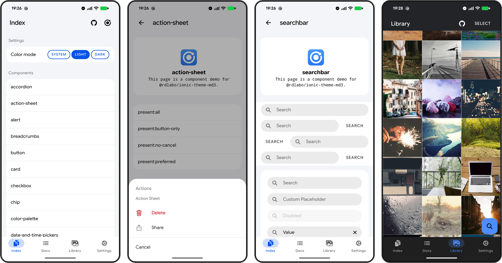

# Ionic Theme Material Design 3

A CSS/JS theme for Ionic applications, using Android Settings as its visual reference while preserving Ionic component APIs and color semantics.

<!-- rdlabo-docs-pick -->



<!-- /rdlabo-docs-pick -->

DEMO is here: https://ionic-theme-md3.rdlabo.dev/

Designed for compatibility with `@rdlabo/ionic-theme-ios27`, so one markup tree can style both Ionic modes.

## Installation

Use the [setup guide](docs/setup.md) to install the package, import
`@rdlabo/ionic-theme-md3/styles/theme.css`, and spread `md3ThemeConfig` into your
existing Ionic initializer's options. Ionic `>=8.8.0 <10` is supported. Apps on older Ionic
versions can use `@rdlabo/ionic-theme-md3@1.0.2`.

For existing apps, follow the [optional setup simplification](docs/migration.md#optional-simplify-the-setup).
For individual CSS files and animation settings, use [configuration](docs/configuration.md).

### Android Settings appearance

The theme keeps Ionic's color semantics and application font overrides. Standard
toggles are icon-free. The MD font default uses the device's local Google Sans Flex
when available, with standard fallbacks; it is included in the theme CSS. No font
initialization code or Capacitor plugin is required. Back icons remain Ionic's responsibility.

See [Android Settings appearance](docs/android-settings.md) for installation,
font fallbacks and component overrides. Existing users should
review the [9.2.0 migration notes](docs/migration.md#migrating-to-920-android-settings-alignment)
for changes to toolbar, list and toggle dimensions.

### Optional: use the MD3 and iOS 27 themes together

Follow [combined theme configuration](docs/configuration.md#use-md3-and-ios-27-together)
for stylesheet ordering and platform-based animation selection.

## Documentation

- [Setup](docs/setup.md) — install and configure the theme with the theme stylesheet and configuration object.
- [Configuration](docs/configuration.md) — individual stylesheets, animations and existing mode selection.
- [Android dynamic colors](docs/dynamic-colors.md) — opt-in Material You setup, light/dark appearance, lifecycle and role mapping.
- [Color system](docs/color-system.md) — Ionic palette defaults, optional Material roles and component color assignments.
- [Android Settings appearance](docs/android-settings.md) — default geometry, CSS font defaults and Ionic customization.
- [Using ion-item-group](https://docs.rdlabo.dev/projects/ionic-theme-md3/docs/using-ion-item-group) — shared inset-list markup for iOS 27 and MD3.
- [Special markup](https://docs.rdlabo.dev/projects/ionic-theme-md3/docs/special-markup) — opt-in component combinations used by the demo.
- [ESLint](https://docs.rdlabo.dev/projects/ionic-theme-md3/docs/eslint) — check list structure with ESLint rules.
- [Migration](docs/migration.md) — optional setup simplification and version-specific upgrade steps.

## Related Projects

If you need a more comprehensive Material Design 3 implementation, you may also be interested in:

- **[md3-for-ionic](https://github.com/danielkleebinder/md3-for-ionic)** by danielkleebinder

> **Note:** This theme is purpose-built for compatibility with Ionic's design approach and `@rdlabo/ionic-theme-ios27`; it is not intended as a strict, full MD3 recreation.

<!-- rdlabo-docs-omit -->

**Full documentation:** [https://docs.rdlabo.dev/projects/ionic-theme-md3](https://docs.rdlabo.dev/projects/ionic-theme-md3)

## Development & Testing

### JavaScript module builds

Keep relative imports in TypeScript source extensionless, matching Ionic's source
style. The shared `rdlabo-build-theme` CLI from `@rdlabo/ionic-theme-utils` uses
tsdown to resolve imports when generating ESM JavaScript and type declarations.
Dependencies remain external, and source files are not rewritten.

Run `npm run build && npm run test:esm` to build and verify the npm tarball with
the shared `rdlabo-check-esm` CLI. Public JavaScript entry points can be imported
in Node.js without a DOM; UI operations still require a browser or a supported
native environment. The package ships ESM only.

### Demo Application

The same demo is deployed against both supported Ionic versions:

- [Ionic 9 demo](https://ionic-theme-md3.rdlabo.dev) — canonical
- [Ionic 8 demo](https://ionic8-theme-md3.rdlabo.dev) — compatibility

The `demo/` directory contains the Angular application used by both deployments. To run it locally:

```bash
cd demo
npm install
npm start
```

### Visual Regression Testing

We use Playwright for visual regression testing to ensure consistent styling across all components. The test suite automatically captures screenshots of all routes in both light and dark modes.

#### Running Tests

```bash
cd demo

# Run all E2E tests
npm run test:e2e

# Run tests in UI mode (interactive)
npm run test:e2e:ui

# Debug tests
npm run test:e2e:debug

# For a PR, request baseline updates with a /update-screenshots comment.
# Review the CI-generated changes before accepting them.
```

### Prerelease channels

An open, non-draft pull request can be published to the npm `beta` dist-tag after its `Lint`, `E2E Screenshot Tests Pull Request`, and `Package Candidate` workflows pass. A repository owner or maintainer must add a comment whose entire body is:

```text
/beta
```

The request authorizes only the pull request head SHA that existed when the comment was added. The workflow revalidates the owner or maintainer permission and head SHA immediately before publishing. Any new commit invalidates the request, regardless of its author; the new SHA must pass CI and receive a fresh owner or maintainer `/beta` comment. Fork pull requests are supported. Pull requests that change a release-gating workflow cannot be beta-published until those workflow changes land on `main`.

Beta versions use `<base>-beta.pr<PR number>.sha<12-character SHA>`. The pull request receives a comment containing the immutable version and exact `npm install` command.

When a pull request is merged into `main`, it is automatically published to the npm `beta` dist-tag only after `Lint`, `E2E Screenshot Tests`, and `Package Candidate` all succeed for that exact merge commit. Direct pushes to `main` do not publish a candidate. Merge candidates use `<base>-beta.pr<PR number>.sha<12-character SHA>` and the merged pull request receives the exact install command.

Candidate code is built in a read-only workflow without npm publishing credentials. The privileged release workflow never checks out or executes pull request code; it revalidates the source workflow and package identity, then publishes only the immutable packed artifact with lifecycle scripts disabled. The install-command comment is a separate best-effort notification and cannot invalidate a successful npm publish.

Only `npm run release` can create a release tag. Stable `vX.Y.Z` tags (major, minor, or patch releases) publish to npm `latest`; revision/prerelease tags publish to `next`. Neither `beta` nor `next` publishing changes the npm `latest` dist-tag.

<!-- /rdlabo-docs-omit -->

<!-- rdlabo-docs-omit -->

## Maintainers

- [rdlabo](https://rdlabo.dev/)
<!-- /rdlabo-docs-omit -->
